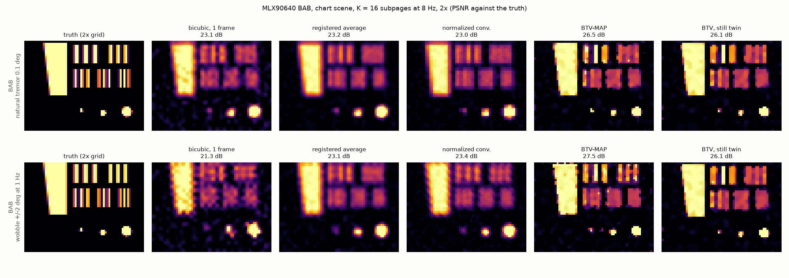

# test_interpolation: tremor-driven super-resolution for the MLX90640 (simulation)

A Python simulation prototype that asks one question: **can small motion of a
handheld MLX90640 (32 x 24 thermopile array) be used for multi-frame
super-resolution, the "move the sensor while shooting" trick behind FLIR
UltraMax?** It simulates the sensor, the hand motion and a gyro, registers the
frames, reconstructs a 2x image and measures how much of any improvement is real
super-resolution rather than noise averaging or a sharpening prior.

Simulation only: no hardware I/O, no deep learning, no OpenCV. The research
behind the design, with sources, is in [docs/RESEARCH.md](docs/RESEARCH.md). All
numbers below come from [docs/results/results.md](docs/results/results.md).



## How the technique works

1. **Sub-pixel diversity.** If the camera moves by a fraction of a pixel between
   frames, each frame samples the scene at slightly different positions. Many
   such frames together sample the scene more densely than one frame.
2. **Registration.** The shift of every frame must be known to a small fraction
   of a pixel. Here it comes from the images (upsampled phase correlation, then
   masked Gauss-Newton), from an integrated gyro, or from a hybrid of both, which
   also estimates the gyro bias and the camera-gyro time offset.
3. **Reconstruction.** A forward model `y_k = D_k B S_k x + n` (shift, optics
   blur and pixel box, then the MLX90640 chess-pattern subpage mask) is inverted
   on a 2x grid. The main method is robust MAP with a bilateral-total-variation
   prior (Farsiu et al. 2004) solved with L-BFGS-B. Baselines: single-frame
   bicubic, the registered multi-frame average (denoising only), normalized
   convolution and iterative back-projection.
4. **The catch.** The MLX90640 has huge pixels: about 0.54 px/deg (BAB, 55 deg)
   or 0.20 px/deg (BAA, 110 deg) horizontally. Physiological tremor is about
   0.1 deg at 8-12 Hz. If every pixel integrates over the full subpage period
   (125 ms at 8 Hz), the tremor averages out into blur inside each exposure.
   The datasheet does not say how the pixels are timed, so the simulator also
   has a "staggered" mode in which each pixel samples its own instant (see
   below).

### What is simulated

- **Scenes** on an 8x canvas in deg C: a resolution chart (slanted edge, bar
  groups at 0.4-0.9 cycles per LR pixel, hot spots), two people with a mug, a
  smooth random texture and text.
- **Motion**: tremor (8-12 Hz) plus slow drift (default 0.2 deg RMS), optional
  deliberate circular wobble, converted to pixel shift with `f_px tan(theta)`.
  A vibration motor (tens to hundreds of Hz) is not modeled; under the
  full-exposure model it would act like large fast tremor (blur), not like the
  slow wobble.
- **Sensor**: exact box integration plus a Gaussian PSF (sigma 0.4 px by
  default; the real PSF is unpublished), motion within each exposure, chess
  subpages exposed at alternating times, NETD from the datasheet scaled by the
  square root of the refresh rate, fixed-pattern offsets, dead pixels (4, the
  datasheet maximum, in the benchmark) and quantization.
- **Exposure timing** (`SensorConfig.exposure`, an assumption either way):
  `"full"` (default), every pixel integrates over the whole subpage period, so
  fast motion becomes blur; or `"staggered"`, the pixels are converted one after
  another in readout order over 1/384 of the period each, so each pixel sees its
  own pose (per-pixel jitter, like a rolling shutter).
- **Gyro**: 400 Hz, 0.007 deg/s/sqrt(Hz) white noise, a random 0.05-1 deg/s bias
  and a 10 ms camera-gyro offset (typical consumer-IMU assumptions).
- **Inverse-crime guard**: the simulator (8x canvas, integral image) and the
  reconstruction operator (separable erf weights on the 2x grid) are separate
  implementations, and the PSF sweep runs with a deliberately wrong assumed PSF.

### How the gain is measured

Every reconstruction is scored against the box-averaged ground truth on the same
grid. PSNR, SSIM, slanted-edge MTF and bar-group resolvability are reported, but
BTV's edge-preserving prior raises all of them even with no motion at all, so the
conclusions rest on paired controls:

- **Registered average**: multi-frame averaging at the native resolution. The
  step from bicubic to this baseline is pure denoising.
- **Still twin**: the same BTV reconstruction run on a twin capture with the
  same seed, noise and fixed pattern but **no motion**. With no motion there is
  no sub-pixel information, so whatever BTV gains here comes from its prior and
  from deconvolving the PSF. `motion dB` = BTV minus the still twin: the total
  effect of the motion, including blur.
- **No-spread twin**: a twin with the same motion *within* every exposure (the
  same blur or jitter) but with each subpage's mean pose removed, so there is no
  sub-pixel spread between subpages. `spread dB` = BTV minus this twin: the
  effect of the spread alone, the only part that can be super-resolution.
- **High-band fidelity** (`HF`): `1 - |H(x - truth)|^2 / |H truth|^2` where `H`
  keeps only frequencies above the sensor's Nyquist (1 = that detail recovered
  exactly, 0 = none, negative = wrong detail). Misplaced or aliased detail lowers
  it, but a prior that suits the scene already scores above 0 with no motion
  (the still twin reaches 0.13-0.14 on the chart and 0.63-0.68 on the people
  scene), so it is used only as a difference: `ΔHF spread` = HF(BTV) minus
  HF(no-spread twin). PSNR can rise without any gain in HF (see below), so a
  result counts as super-resolution here only when `ΔHF spread` is clearly
  positive.

## Results and conclusions

From [docs/results/results.md](docs/results/results.md): 690 simulated cases,
5 seeds each, K = 16 subpages at 8 Hz (2 s), 2x output, gyro-hybrid
registration, full-exposure model unless stated otherwise. Values are mean ± std
over seeds. **BTV is given the true PSF, NETD and fixed-pattern sigma** (except
in the PSF sweep), and its regularization defaults were tuned on the chart, so
these are best-case numbers for the reconstruction.

Chart scene, full-exposure model:

| variant | motion | spread px | blur px | PSNR BTV still | PSNR BTV no-spread | PSNR BTV | motion dB | spread dB | ΔHF spread | HF still → BTV |
|---|---|---|---|---|---|---|---|---|---|---|
| BAB | tremor 0.1 deg, no drift | 0.01 | 0.08 | 26.15 | 26.19 | 26.32 | 0.16 ± 0.19 | 0.13 ± 0.18 | -0.03 ± 0.02 | 0.13 → 0.10 |
| BAB | tremor 0.1 deg (+ drift) | 0.17 | 0.08 | 26.15 | 26.19 | 26.84 | 0.68 ± 0.45 | 0.64 ± 0.47 | 0.04 ± 0.07 | 0.13 → 0.17 |
| BAB | tremor 1 deg | 0.22 | 0.80 | 26.15 | 23.11 | 23.74 | -2.42 ± 0.38 | 0.62 ± 0.21 | -0.01 ± 0.04 | 0.13 → 0.02 |
| BAB | wobble ±1 deg 0.5 Hz | 0.64 | 0.11 | 26.15 | 26.20 | 28.18 | 2.02 ± 0.90 | 1.98 ± 0.92 | 0.10 ± 0.12 | 0.13 → 0.23 |
| BAB | wobble ±2 deg 1 Hz | 1.19 | 0.28 | 26.15 | 26.08 | 27.53 | 1.38 ± 0.43 | 1.45 ± 0.50 | 0.02 ± 0.08 | 0.13 → 0.12 |
| BAA | tremor 0.1 deg (+ drift) | 0.07 | 0.03 | 26.25 | 26.29 | 26.54 | 0.29 ± 0.24 | 0.25 ± 0.24 | 0.03 ± 0.01 | 0.14 → 0.17 |
| BAA | wobble ±2 deg 1 Hz | 0.47 | 0.11 | 26.25 | 26.37 | 28.78 | 2.53 ± 1.11 | 2.40 ± 1.08 | 0.44 ± 0.02 | 0.14 → 0.58 |

Full versus staggered exposure timing (chart, from the exposure sweep):

| variant | motion | motion dB full | motion dB staggered | ΔHF spread full | ΔHF spread staggered |
|---|---|---|---|---|---|
| BAB | tremor 0.1 deg, no drift | 0.16 ± 0.19 | -0.00 ± 0.21 | -0.03 ± 0.02 | -0.03 ± 0.02 |
| BAB | tremor 0.1 deg (+ drift) | 0.68 ± 0.45 | 0.42 ± 0.55 | 0.04 ± 0.07 | 0.03 ± 0.06 |
| BAB | tremor 0.3 deg (+ drift) | 1.44 ± 0.68 | -0.12 ± 1.01 | 0.01 ± 0.04 | -0.05 ± 0.04 |
| BAB | wobble ±1 deg 0.5 Hz | 2.02 ± 0.90 | 1.68 ± 0.82 | 0.10 ± 0.12 | 0.09 ± 0.12 |
| BAB | wobble ±2 deg 1 Hz | 1.38 ± 0.43 | -1.66 ± 1.18 | 0.02 ± 0.08 | -0.10 ± 0.10 |
| BAA | tremor 0.1 deg, no drift | 0.17 ± 0.14 | 0.14 ± 0.14 | -0.01 ± 0.01 | -0.02 ± 0.01 |
| BAA | tremor 0.3 deg (+ drift) | 0.37 ± 0.12 | 0.01 ± 0.23 | 0.01 ± 0.03 | -0.03 ± 0.03 |
| BAA | wobble ±2 deg 1 Hz | 2.53 ± 1.11 | 2.06 ± 0.97 | 0.44 ± 0.02 | 0.42 ± 0.04 |

`spread px` is the RMS sub-pixel diversity of the true subpage shifts, `blur px`
the RMS motion within one exposure (per-pixel jitter in the staggered mode).
Plots: [PSNR vs motion](docs/results/psnr_vs_motion_chart.png),
[MTF curves](docs/results/mtf_curves.png),
[gain vs K](docs/results/gain_vs_k.png),
[PSNR vs refresh rate](docs/results/psnr_vs_refresh.png),
[PSNR vs PSF](docs/results/psnr_vs_psf.png),
[registration vs contrast](docs/results/reg_rms_vs_contrast.png).

**Does natural tremor alone help on the MLX90640? No, under either exposure
model.** Tremor by itself (no drift) leaves 0.01 px of spread between subpages.
Its motion gain on the chart is within the seed scatter (BAB 0.16 ± 0.19 dB
full, -0.00 ± 0.21 dB staggered; BAA 0.17 ± 0.14 and 0.14 ± 0.14 dB), and its
high-band fidelity change is slightly negative in all four cases. The assumed
0.2 deg drift adds 0.17 px of spread on the BAB and raises PSNR (spread dB
0.64 ± 0.47), but the high-band fidelity gain stays within the scatter
(0.04 ± 0.07), so it is not measurable super-resolution. On the people and
smooth-texture scenes natural motion gives no gain at all. Larger tremor hurts:
at 1 deg on the BAB the blur alone takes the no-spread twin from 26.15 to
23.11 dB. Under the staggered model, 0.3 deg tremor on the BAB turns a
1.44 ± 0.68 dB PSNR gain into -0.12 ± 1.01 dB, because the per-pixel jitter is
not modeled by the reconstruction.

**How much does deliberate wobble help? Clearly on the BAA chart; on the BAB
only in PSNR.** A ±2 deg circular wobble at 1 Hz on the BAA gives a spread gain
of 2.40 ± 1.08 dB with ΔHF spread 0.44 ± 0.02 (HF 0.14 → 0.58). This is the
clearest super-resolution in the benchmark, and it holds under the staggered
model (motion dB 2.06 ± 0.97, ΔHF spread 0.42 ± 0.04). The ±1 deg 0.5 Hz
(ΔHF spread 0.26 ± 0.10) and ±2 deg 2 Hz (0.24 ± 0.17) BAA wobbles also show it.
On the BAB the wobble raises PSNR (spread dB 1.45 ± 0.50 at ±2 deg 1 Hz,
1.98 ± 0.92 at ±1 deg 0.5 Hz) but the high-band fidelity gain is within the
scatter (0.02 ± 0.08 and 0.10 ± 0.12), and under the staggered model the 1 Hz
wobble becomes a loss (-1.66 ± 1.18 dB). The BAB shows an HF gain only with more
or faster frames: ΔHF spread 0.15 ± 0.11 at a 16 Hz subpage rate (same 2 s) and
0.14 ± 0.07 with K = 32. The frame-count sweep holds the spread constant by
construction (the motion RMS is normalized per capture), so it shows more frames
with the same spread: the BAA wobble's ΔHF spread rises from 0.02 ± 0.11 at
K = 4 to 0.51 ± 0.06 at K = 32, while for 0.3 deg tremor on the BAB it stays at
or below 0.04 ± 0.06 even though spread dB rises from 1.01 ± 0.51 to
1.94 ± 0.61. **None of this carries over to the people or smooth-texture
scenes**, where wobble gains nothing over the still twin (people BAB
0.36 ± 0.86 dB, BAA -1.77 ± 2.33 dB; texture BAB 0.00 ± 0.29 dB, BAA
-1.45 ± 0.28 dB at ±2 deg 1 Hz).

**How much of the gain is denoising versus super-resolution? Most of the
headline gain is neither.** On the chart with natural tremor (BAB):
- bicubic to registered average (denoising): PSNR 23.28 to 23.32 dB, while the
  flat-region noise falls from 0.585 to 0.251 K. Averaging cleans the noise but
  does not sharpen.
- average to BTV on the still twin (prior plus PSF deconvolution, no motion):
  23.32 to 26.15 dB.
- still twin to the real capture: 26.15 to 26.84 dB, of which the spread
  accounts for 0.64 ± 0.47 dB without a measurable HF gain.

The slanted-edge "effective gain" (MTF50 of BTV over bicubic) is 3.3-4.0 for
most chart cases, but **it is not evidence of super-resolution**: BTV on the
still twin already reaches MTF50 = 1.02 cycles per LR pixel against 0.33 for
bicubic. The same prior helps the piecewise-constant people scene (still twin
34.20 dB against 28.19 dB for the average) and hurts the smooth texture, where
the registered average is the best method (27.84 against 25.81 dB for BTV on
the BAB with natural tremor). That scene has almost no detail above the sensor's
Nyquist, and the chart-tuned regularization is too weak for it.

**Oracle versus estimated shifts: registration is not the bottleneck.** The
hybrid registration error on the chart is 0.014-0.064 px RMS for every motion
except 3 deg tremor, and BTV on the true shifts is between -0.06 and 0.39 dB
better. Image-only Gauss-Newton is close on the chart (`gn - hybrid` between
-0.98 and +0.23 dB). The gyro matters at low contrast: on a 1 K texture the
hybrid reaches 0.108 px against 0.238 px image-only, and at 0.3 K image-only
registration fails (2.862 px) while the hybrid falls back to the bias-limited
gyro (0.526 px). At 3 deg of tremor on the BAB the hybrid falls back to the gyro
for 15 of 15 subpages (0.237 px).

**BAA versus BAB.** The wide BAA turns the same hand motion into less shift
(0.07 vs 0.17 px of spread for natural motion), but also into less blur and
jitter, and it has lower noise (0.40 vs 0.71 K per subpage at 8 Hz). With
deliberate wobble it is the only variant with a clear HF gain at 8 Hz
(HF 0.58 vs 0.12 at ±2 deg 1 Hz). Its lens distortion is not modeled (the shift
grows toward the corners), so BAA results are optimistic.

**Other findings.**
- **The PSF assumption is critical.** Assuming 0.4 px when the true PSF is
  0.2 px makes BTV worse than the registered average even without motion
  (still twin 21.99 dB against 24.38 dB on the BAB); with a wider true PSF
  (0.6-0.8 px) the spread gain is 0.12-0.97 dB and the ΔHF spread at most 0.02.
- **3x output adds no high-band fidelity over 2x** (0.52 vs 0.58 for the BAA
  wobble; ΔHF over the still twin 0.48 ± 0.04 vs 0.44 ± 0.02).
- **Expected gain**: the research estimate of 1.3-1.8x effective linear
  resolution (docs/RESEARCH.md, unverified) cannot be tested with MTF50 here
  because of the prior effect. Measurable recovery of detail above the sensor's
  Nyquist appears only with deliberate wobble on the BAA at 8 Hz (or the BAB with
  more frames), and only on scenes that contain such detail.

## Limitations

- **Simulation only.** Nothing here has been validated on hardware; every
  conclusion depends on the sensor and motion models.
- **Exposure timing is unsourced.** Whether each pixel integrates over the whole
  subpage period (`full`) or is converted in a short staggered window
  (`staggered`) is not in the datasheet. Both are simulated and the conclusions
  above give both; the truth may be in between.
- **Translation-only model.** Reconstruction assumes one uniform shift per
  subpage. Roll, the BAA lens distortion (shift growing toward the corners),
  motion blur within an exposure and per-pixel jitter in the staggered mode are
  simulated or possible but not modeled by the reconstruction.
- **Known noise and PSF.** BTV is given the true PSF, NETD and FPN sigma (except
  in the PSF sweep), and its defaults were tuned on the chart. Real use would
  have to estimate them.
- **Unpublished PSF.** The 0.4 px Gaussian PSF is an assumption; the PSF sweep
  shows how sensitive the results are to it.
- **sqrt(rate) noise scaling.** Per-subpage noise is the datasheet 1 Hz NETD
  times the square root of the refresh rate, which is an assumption, as is the
  flat noise across the array.
- **Motion statistics.** Tremor and drift RMS are normalized per capture, so
  longer captures do not drift further; the gyro and drift parameters are
  typical values, not measurements.
- **Synthetic scenes and tuning.** Piecewise-constant synthetic scenes flatter
  edge-preserving priors; a stronger regularization would likely suit smooth
  scenes better (not benchmarked).
- **Static scene.** Moving objects are not modeled.
- **Image borders.** The outermost LR pixel of the reconstruction can show
  artifacts where shifted samples do not cover the grid; the metrics crop a
  2 LR px border.

## Next steps for hardware

1. **Measure the per-pixel exposure timing** first (for example with a fast pan
   across a sharp edge): it decides whether hand motion blurs or jitters each
   subpage, and whether a per-pixel-shift forward model is needed.
2. **Add a gyro.** A 6-axis MEMS IMU with a gyro data rate of at least 400 Hz,
   a FIFO and a data-ready interrupt (for example the TDK ICM-42688-P, ST
   LSM6DSO or Bosch BMI270 class). Check its noise density against the
   0.007 deg/s/sqrt(Hz) assumed here, and calibrate its bias from a still period
   before each burst. Use the gyro, not the accelerometer: shake is rotation.
3. **Log per-subpage timestamps.** Record each subpage with its subpage ID and
   the host time its data-ready bit was seen, and log the gyro alongside, so the
   camera-gyro offset can be estimated (the hybrid does this by
   cross-correlation).
4. **Avoid Adafruit `getFrame()` merging.** It merges two subpages exposed at
   different times and poses into one frame. With a 1-2 Hz wobble on the BAB
   chart the merged-bicubic baseline is 1.49 ± 0.16 dB (1 Hz) and
   2.63 ± 0.19 dB (2 Hz) below the registered average (0.12 ± 0.11 dB at
   0.5 Hz). Keep each subpage as its own sparse observation, using the Melexis C
   library or raw logging.
5. **Measure the PSF** (for example from a slanted-edge target with the sensor
   stepped on a turntable) and calibrate px/deg the same way; the PSF sweep
   shows a wrong PSF can erase the gain.
6. **Design the motion.** The simulation favors a slow, deliberate, circular
   wobble (about ±1-2 deg at 0.5-1 Hz), the wide BAA lens, and the fastest
   subpage rate the noise allows, rather than relying on natural tremor.

## Install

Python 3.12 or newer.

```bash
python -m venv .venv
. .venv/bin/activate            # Windows: .venv\Scripts\activate
pip install -e .[dev]
```

## Run

```bash
pytest -q                        # fast suite (slow tests are deselected), under a minute
pytest -q -m slow                # benchmark smoke test (run_benchmark.py --quick)
python scripts/demo.py           # writes docs/results/demo_montage.png
python scripts/run_benchmark.py --quick   # smoke run in seconds, written to a new temp directory
python scripts/run_benchmark.py  # full sweep: docs/results/results.{md,csv} and PNG plots
```

The full benchmark (690 cases) took 108 s on 31 worker processes; use
`--jobs N` to limit the processes, `--sweeps central,k,refresh,psf,scale,reg,exposure`
to run a subset and `--full-csv` to also write every metric column. It runs all
sweeps from the plan with 5 seeds each, with these deliberate trims: the
frame-count, refresh, PSF and scale sweeps use the chart scene with two motions
(0.3 deg tremor and ±2 deg 1 Hz wobble) only, the exposure sweep uses the chart
only, and the registration-vs-contrast sweep uses the BAB only.

## Architecture

```
simulate (scene, motion, sensor, gyro) -> register -> reconstruct -> evaluate
```

| Module | Role |
|---|---|
| `mlx_sr/types.py` | Shared dataclasses and conventions (shift `(dx, dy)` in LR px, grids, timing, exposure model, gyro axes) |
| `mlx_sr/scene.py` | 8x HR scenes with metric metadata (chart, people, text, textured, flat) |
| `mlx_sr/motion.py` | Tremor, drift and wobble synthesis, angle-to-shift, gyro simulation |
| `mlx_sr/sensor.py` | MLX90640 forward model producing a `Capture` (subpages plus truth), full or staggered exposure, `truth_at_scale` |
| `mlx_sr/registration.py` | Phase correlation, masked Gauss-Newton, gyro integration, time-offset estimate, hybrid |
| `mlx_sr/operators.py` | Sparse forward operator `A` (shift, erf-integrated box and Gaussian PSF, chess mask) |
| `mlx_sr/reconstruct.py` | Bicubic, registered average, normalized convolution, IBP, BTV-MAP with optional FPN estimation |
| `mlx_sr/metrics.py` | PSNR/SSIM, slanted-edge MTF, bar contrast, hot-spot error, flat sigma, registration RMS, high-band fidelity |
| `mlx_sr/pipeline.py` | `run_pipeline` / `run_case`: method plus all baselines, oracle, still-twin and no-spread-twin controls, gains |
| `scripts/run_benchmark.py` | Sweeps, `results.csv`, `results.md`, plots |
| `scripts/demo.py` | Demo montage |
| `tests/` | Forward model, registration, operators, reconstruction, metrics and pipeline tests |

## License and status

Research prototype. See [docs/RESEARCH.md](docs/RESEARCH.md) for the
literature, the sensor facts and the full list of sources.
